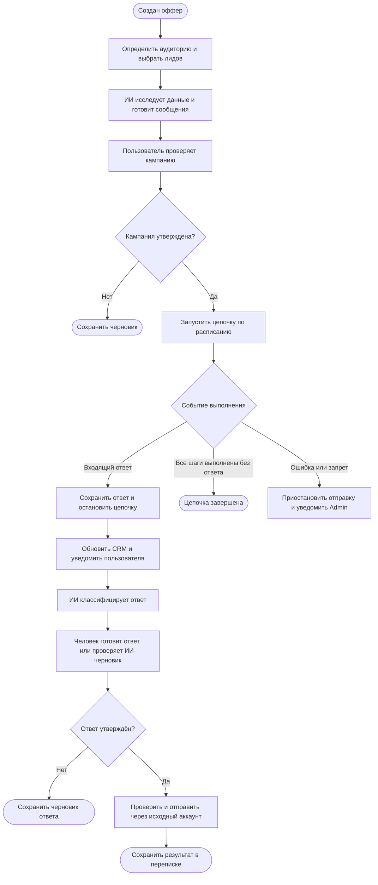

# LeadWeave AI

**Сплетаем данные в личный диалог.**

LeadWeave AI — проект веб-платформы для персонализированного привлечения потенциальных клиентов через Telegram, LinkedIn и Email.

Система должна объединить данные о человеке и компании, историю переписки, описание продукта, выбранный оффер и инструкции пользователя, чтобы подготовить уместное сообщение и довести коммуникацию до предметного разговора с человеком.

## Статус проекта

**Этап: требования и проектирование.** В репозитории размещена стартовая документация. Код приложения, рабочие интеграции, тесты и развёртывание пока отсутствуют.

Функции ниже описывают целевую систему и объём MVP. Они не являются перечнем уже реализованных возможностей. Стек, модели, провайдеры, бюджет и сроки ещё не выбраны.

- [Основной сценарий, схемы и правила обработки исключений](docs/main-scenario.md)
- Основа требований: предоставленный документ «TR  outreach bot.docx» и инструкции проекта LeadWeave AI. Эти исходные материалы отдельно в репозитории не размещены.

## Какую задачу решаем

Менеджер тратит время на поиск контактов, изучение компаний, подготовку персональных сообщений, повторные обращения и разбор ответов. LeadWeave AI должен связать эти действия в один управляемый процесс.

Центральный объект — **лид**: потенциальный клиент с профилем, источниками данных, историей общения, заметками и текущим состоянием работы.

## Основные модули

| Модуль | Требуемый результат |
| --- | --- |
| CRM и база лидов | Карточки людей и компаний, импорт, поиск, фильтры, списки, теги и дедупликация |
| Офферы и аудитории | Описание предложения, ограничения, призыв к действию и профиль целевого клиента — ICP |
| Поиск и исследование | Поиск лидов по критериям, сбор доступных данных, источники и объяснение релевантности |
| ИИ-персонализация | Сообщения с учётом фактов, оффера, переписки, заметок и явных инструкций |
| Кампании | Предпросмотр, утверждение, последовательности сообщений, расписание, Pause и Stop |
| Каналы и аккаунты | Независимые адаптеры Telegram, LinkedIn и Email; несколько аккаунтов отправителей |
| Inbox и ответы | История переписки, остановка цепочки, классификация, уведомления и передача человеку |
| AI Reply Assistant | Превращение введённого пользователем смысла в черновик ответа с подтверждением отправки |
| Управление и аналитика | Admin, принадлежность данных, аудит и показатели кампаний |

## Основной сценарий

Пользователь создаёт оффер, определяет аудиторию, выбирает лидов и утверждает кампанию. Платформа выполняет отправки в согласованных пределах. Полученный ответ останавливает связанную автоматическую цепочку и становится доступен человеку в Inbox.

Это обзор логики, а не диаграмма реализованного приложения. В подробном сценарии отдельно описаны проверки перед каждым сообщением, ожидания, сбои и поздние ответы.

## Правила кампаний

- По умолчанию — три сообщения: **дни 0, 5 и 10**. Интервалы, рабочие часы и часовой пояс настраиваются.
- Перед запуском пользователь проверяет оффер, аудиторию, каналы, аккаунты, расписание, стратегию и примеры сообщений.
- Автоматические отправки допустимы только в пределах утверждённой версии кампании.
- Перед каждым сообщением сервер повторно проверяет права, утверждение, состояние лида, остановку цепочки, запрет контакта, аккаунт, лимиты, расписание и отсутствие уже выполненной отправки.
- Входящий ответ останавливает связанную цепочку **до ИИ-классификации**. Недоступность модели не должна мешать остановке или приёму ответов.
- Do Not Contact блокирует новые исходящие сообщения. Инструкции кампании и текст промпта не могут отменить этот запрет.
- Ответ из платформы отправляется через канал и аккаунт соответствующей переписки после подтверждения пользователем.
- Отправка и доставка учитываются раздельно. Если канал не сообщает о доставке, её состояние остаётся неизвестным.

## Роли ИИ, платформы и человека

| Участник | Ответственность |
| --- | --- |
| ИИ | Анализ оффера и данных, предложение ICP, исследование, черновики сообщений, объяснение персонализации и классификация ответов |
| Платформа | Права доступа, состояние кампаний, расписание, очередь, запреты, отправка, приём событий, защита от повторов и аудит |
| Человек | Проверка аудитории и стратегии, запуск кампании, сложные вопросы, переговоры и подтверждение индивидуальных ответов |

ИИ не должен выдумывать факты, прошлые знакомства, свойства продукта, цены, скидки или гарантии. При недостатке данных нужен нейтральный черновик либо уточнение.

## Данные и границы доступа

Основные сущности: Workspace, User, Lead, Company, Offer, Target Audience/ICP, Lead List, Tag, Research, Source, Note, AI Instruction, Campaign, Sequence, Sequence Step, Sending Account, Conversation, Message, Notification, Activity/Event, Tariff/Subscription.

- Бизнес-статус лида отделяется от состояния отправки и доставки.
- Участие лида в кампании и прохождение цепочки учитываются отдельно для каждой кампании.
- Обычные заметки и явные инструкции для ИИ хранятся раздельно.
- Для исследовательских фактов сохраняются источник, ссылка и время получения; выводы ИИ отмечаются как предположения.
- В MVP используется роль Admin. Модель данных сразу предусматривает workspace/owner и последующую изоляцию пользователей.
- Общая база лидов не должна раскрывать будущему пользователю чужие заметки, кампании или переписку. Правила выдачи лидов из общей базы требуют отдельного решения.

## Надёжность и безопасность

Сайты, профили, документы и входящие сообщения считаются недоверенными данными. Содержащийся в них текст не может менять права, адресатов, правила системы или разрешения на отправку.

Модель предлагает текст; сервер проверяет разрешения и выполняет действие через адаптер канала. Токены и пароли не попадают в промпты, клиентский код и обычные журналы.

Требуются устойчивое хранение состояния, восстановление после перезапуска, ограниченные повторы, аудит, защита от повторных событий и аварийная остановка отправок. При неизвестном результате отправки сначала нужна сверка состояния или ручная проверка; слепой повтор недопустим.

## Объём MVP

Полный MVP по исходному ТЗ включает CRM, офферы и аудитории, поиск и исследование лидов, персонализацию, кампании, **все три целевых канала**, входящие ответы, остановку цепочек, уведомления, передачу человеку, ответы из платформы и базовую административную часть.

На следующий этап допускается перенести полноценный биллинг, самостоятельную регистрацию пользователей, A/B-тестирование, автоматические переговоры, дополнительные каналы, сложные CRM-интеграции и расширенную аналитику.

Проверка одного канала может быть промежуточным этапом разработки; она не означает готовность полного MVP.

## Критерий приёмки

В тестовой среде пользователь должен пройти весь путь:

1. Создать оффер и определить аудиторию.
2. Получить или импортировать лидов, выбрать их и создать кампанию.
3. Проверить персонализацию и утвердить запуск.
4. Проверить цепочку дней 0, 5 и 10; для теста время можно ускорить с сохранением логики.
5. Получить тестовый ответ и увидеть остановку следующих сообщений, историю и уведомление.
6. Подготовить ответ с помощью ИИ, подтвердить и отправить его через исходный канал.
7. Убедиться в отсутствии отправок после отказа, повторных сообщений при сбоях и доступа к чужим данным.

Полный MVP принимается после проверки применимых сценариев на каждом из трёх каналов. Результаты реальных проверок фиксируются отдельно от планов.

## Порядок разработки

1. Уточнить карту требований и открытые решения из [основного сценария](docs/main-scenario.md#открытые-решения).
2. Проверить по официальным источникам способы подключения каждого канала: отправку, входящие события, ограничения и доступ.
3. Выбрать стек и описать модель данных, состояния и контракты адаптеров.
4. Проверить сценарий без реальных отправок, включая остановку, отказы и сбои.
5. Подключить тестовые аккаунты, затем провести ограниченный согласованный пилот.

Команды установки и запуска появятся вместе с проверенной реализацией. Поддержка каналов сейчас является требованием, а не подтверждением доступности конкретного API или провайдера.
