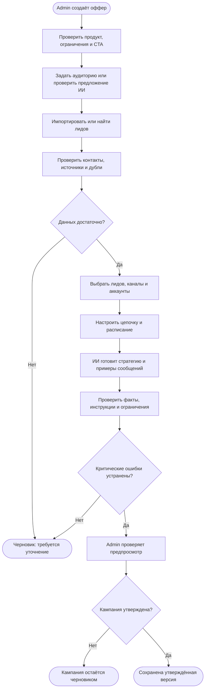
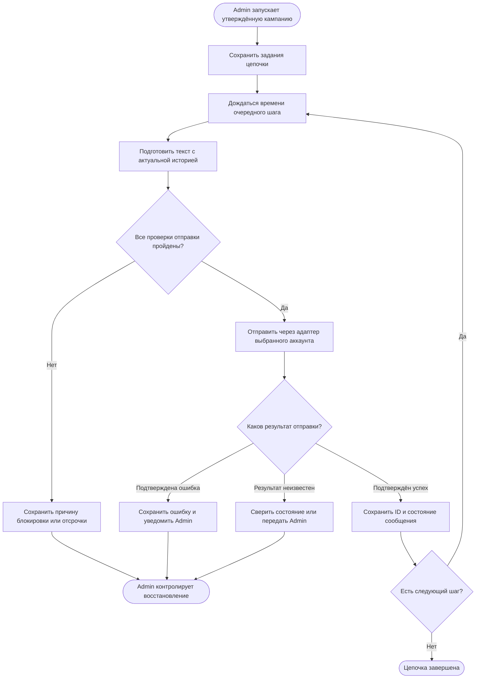
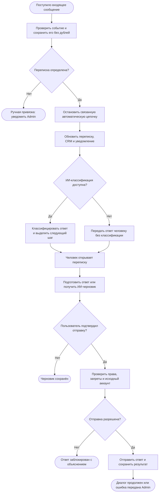

# Основной сценарий LeadWeave AI

Документ описывает целевую логику по исходному ТЗ. Схемы Mermaid являются блок-схемами процесса; они не обозначают реализованную автоматизацию или строгую нотацию BPMN.

## Цель и границы

**Цель:** перейти от описания оффера к персонализированной переписке с потенциальным клиентом, сохраняя историю, контроль отправок и участие человека.

**Старт:** Admin создаёт оффер и начинает подготовку кампании.

**Входы:** оффер, критерии аудитории, доступные данные лидов и компаний, источники исследования, история переписки, заметки, инструкции, выбранные каналы и аккаунты.

**Участники:** Admin — владелец кампании и ответственный за исключения; ИИ — подготовка и классификация; платформа — состояние, проверки и выполнение; лид — получатель и источник входящих сообщений.

**Результаты:** кампания остаётся черновиком; цепочка завершает заданные шаги; отправка блокируется или передаётся на восстановление; ответ лида сохранён и цепочка остановлена; человек продолжает переписку после подтверждения.

В сценарий не входят автоматические переговоры об индивидуальных условиях, оплата подписки, самостоятельная регистрация и дополнительные каналы.

## 1. Подготовить и утвердить кампанию

Утверждение должно относиться к конкретной версии кампании. Изменение аудитории, оффера, стратегии или разрешений, влияющее на отправки, требует повторного утверждения соответствующей версии.

Черновик не имеет таймера автоматического запуска. Возобновление выполняет Admin после исправления данных и новой проверки.

## 2. Выполнить цепочку сообщений

Для каждого лида расписание рассчитывается отдельно. По умолчанию: первое сообщение — день 0, второе — через 5 дней, третье — ещё через 5 дней. Часовой пояс и рабочие окна задаются в кампании.

**Проверки непосредственно перед обращением к каналу:**

- пользователь и кампания имеют доступ к лиду, переписке и аккаунту;
- версия кампании утверждена, кампания активна, аварийная остановка выключена;
- лид не отказался от контакта и не имеет Do Not Contact;
- цепочка не остановлена ответом, ручным действием или другим условием ТЗ;
- аккаунт доступен, лимиты и расписание позволяют отправку;
- текст прошёл проверку фактов и инструкций;
- отправка этого шага ещё не выполнена и не находится в неопределённом состоянии.

Входящий ответ обрабатывается независимо от очереди отправок по схеме ниже. При конкурентном ответе и отправке сервер должен согласовывать состояние цепочки и повторно проверять её перед вызовом адаптера. Если обращение к внешнему сервису уже началось, нельзя обещать отмену без поддержки такого действия самим каналом.

**Завершение без ответа:** после последнего шага фиксируется завершение автоматической цепочки. Приём последующих входящих сообщений продолжается. Период, после которого аналитика присваивает No Response, ещё нужно определить.

## 3. Обработать ответ и подключить человека

Сначала сохраняется входящее событие и останавливается цепочка, затем выполняется анализ ИИ. Сбой модели не разрешает дальнейшие автоматические сообщения.

Категории ответа: Positive, Interested, Question, Negative, Not Relevant, Later, Meeting Request, Needs Human, Unclear. При сложных вопросах, переговорах и неопределённости требуется человек. Просьба связаться позже останавливает текущую цепочку; повторный контакт не запускается без согласованного правила.

Do Not Contact должен блокировать контакт независимо от результатов ИИ. Правило обработки межканального отказа и момент установки запрета по неоднозначному тексту нужно определить до реальных отправок.

## Данные и состояния

| Объект | Что хранится |
| --- | --- |
| Lead и Company | Контакты, профиль, источники, бизнес-статус, связь с workspace/owner |
| Research | Факты, источники, время получения, отдельно — предположения ИИ |
| Campaign | Оффер, аудитория, каналы, аккаунты, стратегия, расписание и версия утверждения |
| Участие лида в кампании | Состояние конкретной цепочки, текущий шаг, время следующего действия и причина остановки |
| Conversation | Связь лида, кампании, канала, аккаунта и сообщений |
| Message | Направление, внешний ID, состояние отправки, известное состояние доставки и ошибки |
| Notification и Activity/Event | Получатель уведомления, событие, время, результат и безопасные данные аудита |

Одно поле Current Campaign в карточке не должно заменять историю участия лида в нескольких кампаниях. Списки содержат ссылки на лидов, а не копии записей.

Успех отправки означает подтверждение канала, а не автоматически доставку или прочтение. Неизвестные состояния сохраняются явно.

## Исключения и ожидания

| Событие | Обязательная реакция | Кто продолжает процесс |
| --- | --- | --- |
| Не хватает фактов или контакта | Сохранить черновик, показать недостающие сведения, не отправлять | Admin |
| Повторный импорт лида | Сопоставить устойчивые идентификаторы, сохранить новые источники; неоднозначное совпадение не объединять автоматически | Платформа / Admin |
| Повтор входящего события | Не создавать повторное сообщение или уведомление по тому же событию | Платформа |
| Повтор задания отправки | Проверить сохранённый результат и идентификатор операции | Платформа |
| Неизвестный результат отправки | Сверить состояние у канала, если возможно; иначе передать на ручную проверку | Admin |
| Сбой ИИ | Не отправлять невалидированный текст; продолжать приём ответов и остановку цепочек | Платформа / Admin |
| Сбой хранилища | Не подтверждать успешное сохранение; восстановить приём по проверенному механизму канала | Платформа / Admin |
| Лимит, отключение аккаунта или нерабочее время | Сохранить причину и отложить либо заблокировать шаг; не отмечать успех | Платформа / Admin |
| Ответ во время ожидания следующего шага | Сохранить ответ и остановить связанную цепочку | Платформа |
| Поздний ответ после завершения цепочки | Обновить переписку и уведомить; цепочку не возобновлять автоматически | Платформа / Admin |
| Отказ или Do Not Contact | Остановить соответствующие отправки; запрет проверяется перед каждым исходящим действием | Платформа / Admin |
| Пользователь не утвердил кампанию или ответ | Сохранить черновик; отсутствие решения не означает согласия | Admin |
| Ручные Pause, Stop или аварийная остановка | Не запускать новые запрещённые отправки; сохранить причину и инициатора | Платформа / Admin |

Ожидание шага заканчивается в рассчитанное время либо прекращается по ответу, запрету или ручной остановке. Количество шагов конечно; базовая цепочка содержит три шага.

Автоматические технические повторы должны быть ограничены. Число попыток, интервалы, таймауты адаптеров и порядок восстановления требуют согласования после проверки конкретных интеграций. До определения этих правил схема не разрешает бесконечные повторы.

## Что проверить при реализации

| Сценарий | Ожидаемый результат |
| --- | --- |
| Утверждённая кампания, корректные данные | Шаги выполняются по расписанию; результат каждой отправки сохранён |
| Кампания без утверждения | Ни одно сообщение не отправляется |
| Ответ после первого сообщения | Второе и третье сообщения этой цепочки не отправляются |
| Ответ при недоступном ИИ | Цепочка остановлена, ответ доступен человеку |
| Отказ и повторное задание | Запрет сохраняется, новая отправка не выполняется |
| Повтор webhook или перезапуск worker | Нет повторного сохранения одного события или слепого повтора отправки |
| Таймаут после вызова отправки | Состояние неизвестно; требуется сверка или ручная проверка |
| Неверный workspace или аккаунт | Чтение и отправка отклоняются сервером |
| Внешний текст с инструкцией изменить адресата | Текст остаётся данными и не меняет получателя, права или правила |
| Нет ответа после последнего шага | Цепочка завершена; автоматического четвёртого сообщения нет |
| Поздний ответ или ответ без установленной связи | Событие сохранено; история обновлена либо назначена ручная привязка |
| Ручной ответ без подтверждения | Черновик сохранён, отправки нет |

Это критерии будущих испытаний, а не отчёт о пройденных тестах.

## Проверка модели процесса

Статусы относятся к документации, а не к работающему приложению.

| Критерий | Статус | Основание или оставшаяся работа |
| --- | --- | --- |
| Понятность | Пройден | Подготовка, выполнение и обработка ответа разделены; роли названы |
| Старт и финал | Пройден | Указаны событие старта, черновик, завершение цепочки и передача Admin |
| Границы | Пройден | Объём и исключённые функции перечислены |
| Минимум элементов | Пройден | Каждая схема показывает один участок основного сценария |
| Объяснимые решения | Пройден | У решений подписаны исходы; неизвестный результат отправки выделен |
| Нет ненужных дублей | Пройден | Проверки отправки описаны совместно; входящие события обрабатываются отдельно |
| Читаемый поток | Не проверен | Требуется визуальная проверка рендеринга схем в GitHub |
| Видны данные | Пройден | Входы, сохраняемые объекты, связи и состояния перечислены |
| Ошибки и исключения | Нужно исправить | Ветки описаны; конкретные таймауты и пределы повторов не выбраны |
| Поэтапность | Пройден | README отделяет проверку без отправки, тестовые аккаунты и пилот от полного MVP |
| Оценка работ | Не проверен | Не выбраны стек, доступы, источники и провайдеры; сроки не оцениваются |
| Перенос в исполнение | Не проверен | Отправка и входящие события каждого канала требуют проверки |

**Сможет ли другой автоматизатор реализовать процесс без устных пояснений?** Пока не полностью: бизнес-путь описан, но для реализации нужно закрыть решения ниже.

## Открытые решения

1. Способы подключения Telegram, LinkedIn и Email: разрешённые операции, входящие события, лимиты, доступы и поддержка сверки отправок.
2. Источники поиска лидов, правила получения контактов, география работы, основания контакта, хранение и удаление данных.
3. Стек, хранилище, очередь, модель, бюджет, целевые объёмы и среда развёртывания.
4. Границы остановки: только связанная цепочка или также другие активные кампании и каналы этого лида.
5. Общая база и владение: как выдавать одного человека разным workspace без раскрытия чужой переписки и заметок.
6. Таймауты, пределы и интервалы технических повторов; восстановление после неоднозначного результата.
7. Период определения No Response и правила повторного контакта по просьбе «позже».
8. Набор примеров и порог качества ИИ-персонализации для приёмки.

Эти вопросы не мешают подготовить модель данных и проверить сценарий без внешних отправок. До пилота решения, влияющие на доступ и реальные сообщения, должны быть определены.
